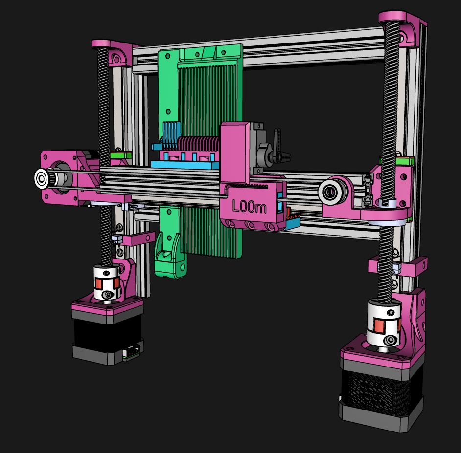

# L00m – computergesteuerter Jacquard-Webstuhl



L00m ist ein Jacquard-Webstuhl im Eigenbau für den Schul- und Kunstbetrieb. Statt der klassischen
Platinen-Mechanik wählt ein kleiner Aktor (RC-Servo) die Kettfäden einzeln aus, ein zentraler Hub (zwei
Schrittmotoren an Trapezgewindespindeln) hebt alle gewählten Fäden gemeinsam an. Gesteuert wird das Ganze wie ein
3D-Drucker oder eine CNC-Fräse: ein Muster wird in G-Code übersetzt und an einen Controller mit grblHAL geschickt.

Ziel ist eine langlebige, wartungsarme und sichere Maschine (5–10 Jahre Einsatz), die sich mit Teilen aus dem
3D-Druck-Umfeld nachbauen lässt.

> **Hinweis:** L00m ist ein Prototyp in Entwicklung und kein geprüftes Gerät. Das Sicherheitskonzept
> (Strombegrenzung, Not-Aus) ist noch nicht umgesetzt. Nachbau und Betrieb auf eigene Verantwortung.

## Stand (Oktober 2026)

| Bereich | Stand |
|---|---|
| Konzept & Recherche | fertig, siehe `01 Konzept & Quellen` und `02 L00m Entwicklungsgenese` |
| CAD (Shapr3D) | in Arbeit, Stand 19.10.2026 |
| Elektronik & Firmware | aufgebaut und getestet: grblHAL auf FYSETC R4, X + Dual-Z (TR8x8) mit Squaring, Servo per `M280` – Repo [L00m-grblHAL](https://github.com/DeRGiPsKoPf/L00m-grblHAL) (in Entwicklung) |
| Muster-Generator (Bild → G-Code) | Repo [L00m-Pattern](https://github.com/DeRGiPsKoPf/L00m-Pattern) (in Entwicklung): Bild, Textraster, Formel → G-Code, direkt senden per USB; Probelauf am Gerät läuft |
| Steuerzentrale pro Loom (WLAN, Anzeige, Taster, mehrere Looms) | geplant im Repo [L00m-Host](https://github.com/DeRGiPsKoPf/L00m-Host) (in Entwicklung, ESP32-S3) |
| Mechanik-Aufbauanleitung | fehlt noch |
| Sicherheitskonzept (Strombegrenzung, Not-Aus) | geplant, noch nicht umgesetzt |

## Zusammenspiel der Repos

```
                L00m (Mechanik, CAD, Konzept) – beschreibt die Maschine
                        │
L00m-Pattern ──G-Code───┼──► heute:   USB (Web Serial) ─────────────────────────► R4 mit L00m-grblHAL
(Muster-App)            └──► geplant: WLAN ──► L00m-Host (ESP32-S3) ──UART──► R4 mit L00m-grblHAL
                                                   └╌╌ Funk ╌╌► weitere Looms (je S3 + R4)
```

Öffentlich ist bisher nur dieses Repo. Die anderen drei sind **in Entwicklung** und noch nicht freigegeben; ihre
Links führen erst nach der Veröffentlichung zum Ziel.

| Repo | Inhalt | Lizenz | Braucht | Wird gebraucht von |
|---|---|---|---|---|
| **L00m** (dieses) | Mechanik (CAD), Konzept, Entwicklungsgenese, Renderings | offen: CERN-OHL-S-2.0, CC BY-SA 4.0 | – | allen: Maße, Verfahrwege, Ablauf pro Schuss |
| [L00m-grblHAL](https://github.com/DeRGiPsKoPf/L00m-grblHAL) (in Entwicklung) | grblHAL-Patch für den FYSETC R4, fertige `.uf2`, Anleitung | offen: GPL-3.0-or-later, Anleitung CC BY-SA 4.0 | grblHAL/RP2040 (Commit `2f5bc4a`) | L00m (die Maschine bewegt sich), L00m-Pattern (Profile und Vorlagen passen zum Firmware-Stand), L00m-Host (zweiter Kanal `MPG_ENABLE 2`, Chip-ID in `$I`) |
| [L00m-Pattern](https://github.com/DeRGiPsKoPf/L00m-Pattern) (in Entwicklung) | Muster-App → G-Code, Maschinenprofile, G-Code-Vorlagen | proprietär | L00m-grblHAL (`M280`, `G4`, `M0`, Soft-Limits) | L00m-Host (liefert `l00m.html` aus, übernimmt die Sende-Logik) |
| [L00m-Host](https://github.com/DeRGiPsKoPf/L00m-Host) (in Entwicklung) | Firmware für den ESP32-S3 am Loom (geplant) | proprietär | L00m-grblHAL (MPG-Kanal, Chip-ID), L00m-Pattern (`l00m.html`, WebSocket) | – |

## Aufbau des Repos

```
01 Konzept & Quellen - Jacquard-Webstuhl.pdf   Aktor-Varianten, Skalierung, Maker-Projekte als Quellen
02 L00m Entwicklungsgenese.pdf                 Mechanik-, Antriebs-, Strom- und Sicherheitsentscheidungen
Bilder/                                        Renderings
CAD/
  Project L00m - 20261019.shapr                Shapr3D-Projekt (Arbeitsdatei)
  L03m.step.zip                                STEP-Export der Baugruppe, Projektversion 3 (gezippt, entpackt 171 MB)
LICENSES/                                      vollständige Lizenztexte
```

Die Firmware (bis 23.10.2026 hier unter `Firmware/`) liegt jetzt in
[L00m-grblHAL](https://github.com/DeRGiPsKoPf/L00m-grblHAL) (in Entwicklung), mit Schnellstart zum Flashen und der Anleitung zum
Verkabeln.

## Lizenz

Open Source, je nach Dateiart – Details in [LICENSE.md](LICENSE.md):

- CAD-Daten: **CERN-OHL-S-2.0** (ausgenommen eingebundene Norm- und Herstellerteile, siehe LICENSE.md)
- Dokumentation (PDFs, Markdown, Bilder): **CC BY-SA 4.0**

## Kontakt

Fragen und Ideen bitte über die GitHub-Discussions dieses Repos.
